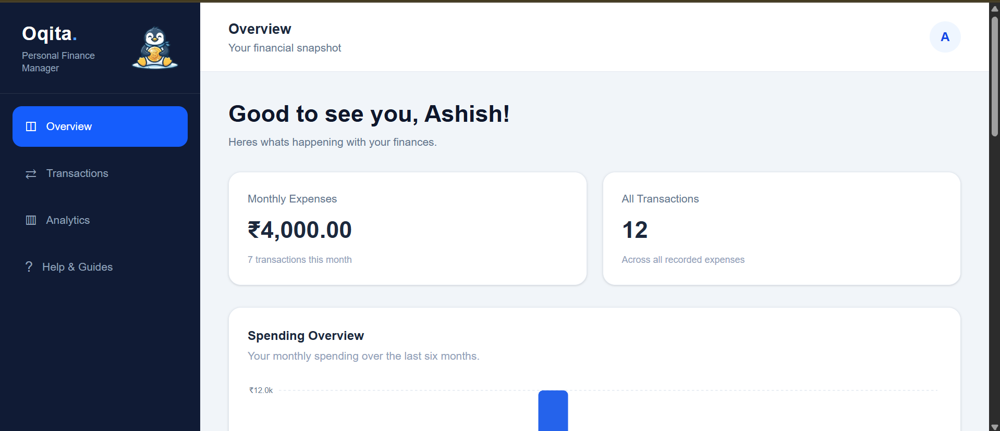
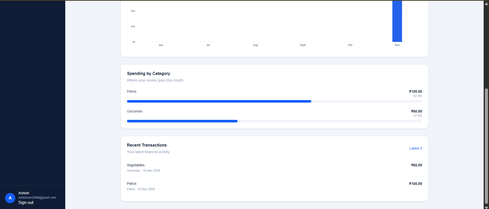
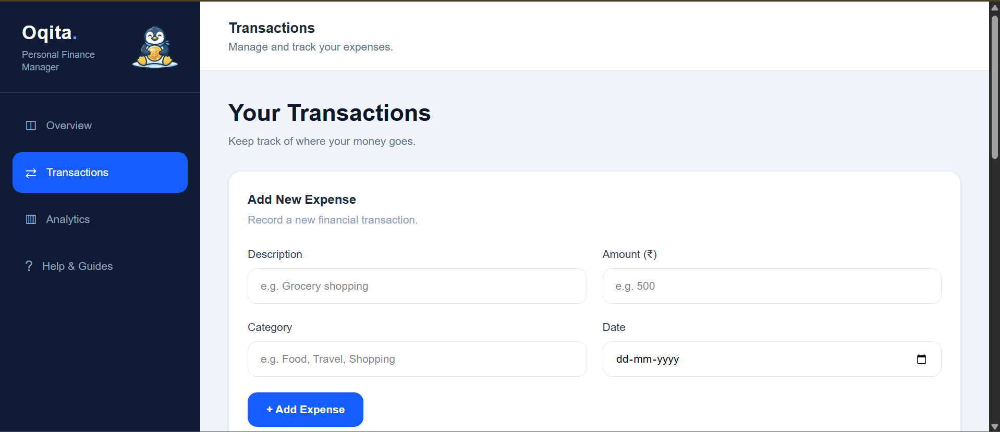
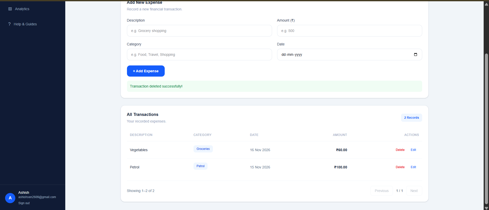
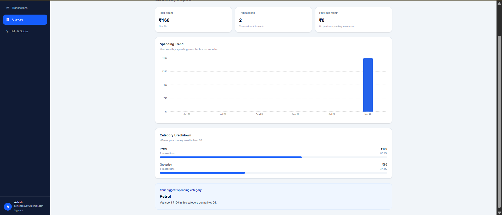
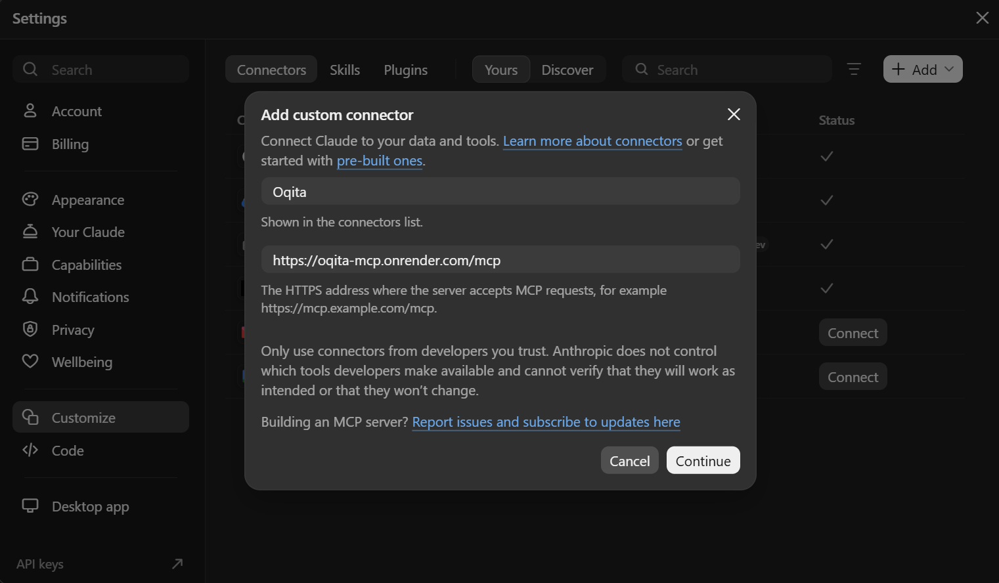
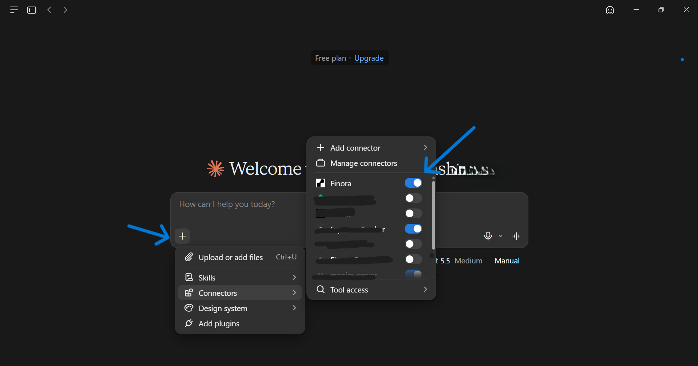
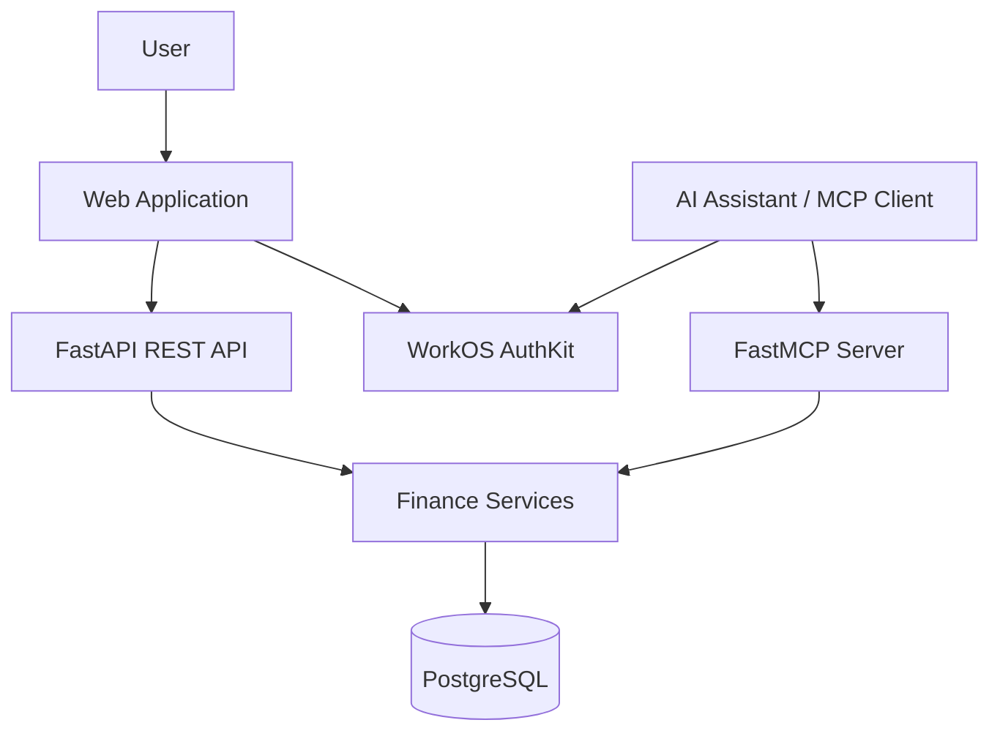

# Oqita — AI-First Personal Finance Manager

**Manage your expenses. Understand your spending. Interact with your finances through AI.**

Oqita is an AI-first personal finance manager that combines a web-based finance dashboard with a Model Context Protocol (MCP) server.

It allows users to manage and analyze their expenses through a traditional web application or interact with their financial data using compatible AI assistants.

Unlike a conventional expense tracker with a chatbot added on top, Oqita treats MCP as a first-class interface to its finance capabilities.

🌐 **Live application:** https://oqita.vercel.app  
🔌 **MCP endpoint:** https://oqita-mcp.onrender.com/mcp  
▶️ **youtube video:** https://youtu.be/BLz-evaZ7xg

---
## ✨ Features

### Finance Dashboard
- View monthly spending summaries.
- Review recent transactions.
- Understand spending patterns through category breakdowns.
- Explore monthly spending trends.




### Transaction Management
- Add, edit, and delete expenses.
- Browse transactions with pagination.
- Filter expenses by date and category.




### Analytics
- Monthly spending summaries.
- Category-wise expense breakdowns.
- Historical monthly spending trends.
- Previous-month spending comparisons.



### AI-Native Finance Interaction
Oqita exposes its finance operations through an MCP server, allowing compatible AI clients to interact with authenticated financial data.

Users can use natural-language requests such as:

- "Add ₹250 for groceries today."
- "Show my expenses from this month."
- "How much did I spend last month?"
- "Break down my spending by category."
- "Show me my spending trend over the last six months."

The AI client can use the available MCP tools to perform the corresponding operations.

.png)
.png)

## 🧠 MCP Integration

MCP is a core part of Oqita architecture.

The MCP server exposes the following tools:

| Tool              | Description |
|-------------------|
| `add_expenses`    | Add an expense |
| `get_expenses`    | Retrieve expenses with optional date and category filters |
| `update_expense`  | Update an existing expense |
| `delete_expense`  | Delete an expense |
| `get_monthly_summary` | Retrieve a monthly spending summary |
| `get_category_summary` | Retrieve spending grouped by category |
| `get_monthly_trend` | Retrieve historical monthly spending trends |


### Connect to Oqita

Use the following remote MCP endpoint in a compatible MCP client:

```text
https://oqita-mcp.onrender.com/mcp
```


Oqita uses WorkOS AuthKit for authentication. The client must support the authentication flow required by the remote MCP server.

Once authenticated and linked to a Oqita account, the client can access the available finance tools.




---

## 🏗️ Architecture

Oqita separates its web application, REST API, and MCP interface while using shared finance services and database models.



### Authentication and Data Isolation

- WorkOS AuthKit handles user authentication.
- The backend verifies authenticated identities.
- Authenticated WorkOS identities are mapped to local Oqita users.
- The MCP server resolves the user from the verified authentication context rather than accepting a user ID supplied by an AI client.
- Finance operations are scoped to the authenticated user.

---

## 🛠️ Tech Stack

### Backend
- Python 3.13+
- FastAPI
- FastMCP
- SQLAlchemy
- Alembic
- PostgreSQL
- Psycopg

### Frontend
- Next.js
- React
- TypeScript
- Tailwind CSS
- TanStack Query
- Recharts

### Authentication and Infrastructure
- WorkOS AuthKit
- Neon PostgreSQL
- Render
- Vercel

---

## 📂 Project Structure

```text
Mcp-ExpenseTracker/
│
├── DB/                 # Database models and connection
├── alembic/            # Database migrations
├── frontend/           # Next.js application
├── middleware/         # MCP HTTP security and request protection
├── services/           # Shared finance business logic
│
├── main.py             # FastMCP server
├── api.py              # FastAPI REST API
├── pyproject.toml      # Python dependencies
├── uv.lock             # Python dependency lockfile
└── README.md
```

## 🔐 Security Considerations

Oqita includes several security mechanisms:

- WorkOS-based authentication.
- Server-side identity verification.
- User-scoped finance operations.
- MCP request-size protection.
- MCP HTTP host and origin security middleware.
- Rate limiting for MCP tool calls.

The application is designed so that an AI client cannot select another user's account simply by supplying a different user ID.

---

## 🎯 Project Vision

Oqita explores a different approach to personal finance software: instead of making users adapt to a fixed set of screens and forms, it makes finance operations accessible through both a conventional interface and AI-driven interactions.

The goal is to make personal finance management more accessible, conversational, and extensible through the MCP ecosystem.

---

## 👨‍💻 Author

**Ashish Sen**

B.Tech — Information Technology

GitHub: https://github.com/Ashish96300

---

*Oqita — Your finances, accessible through the interfaces you already use.*